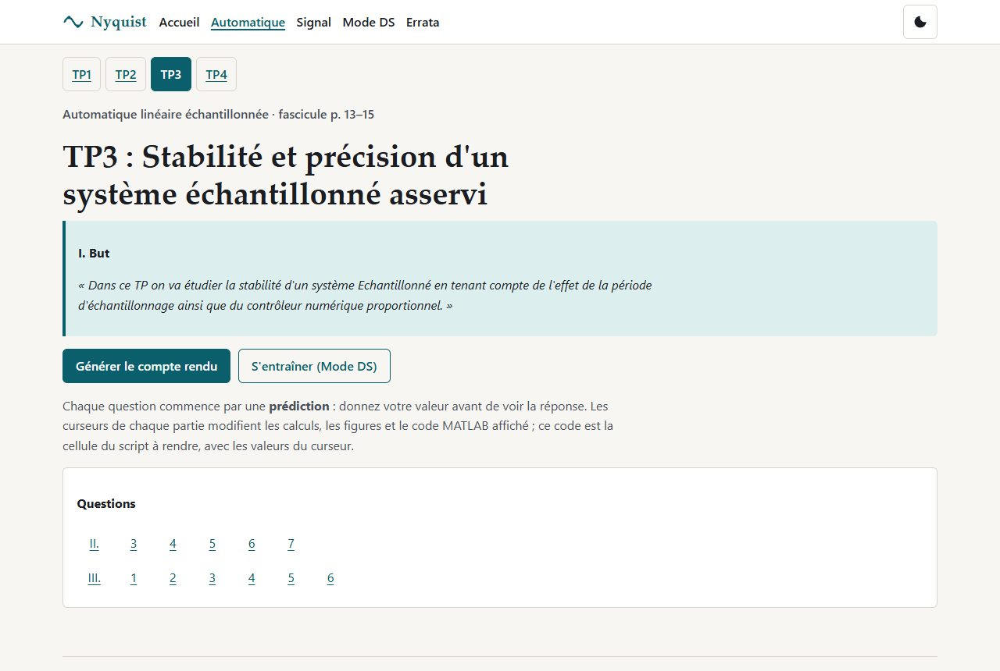
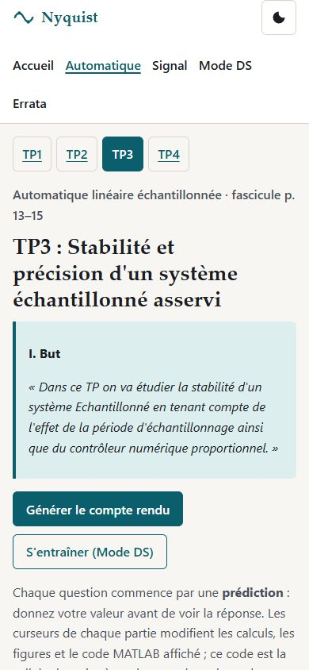
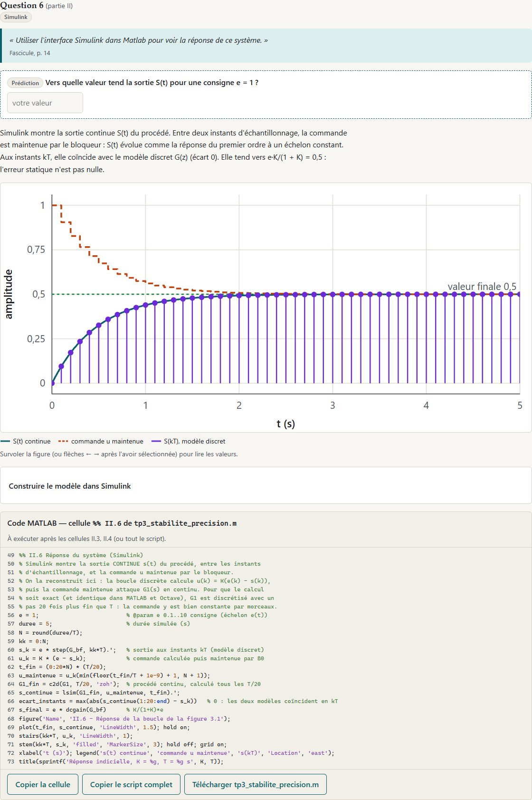
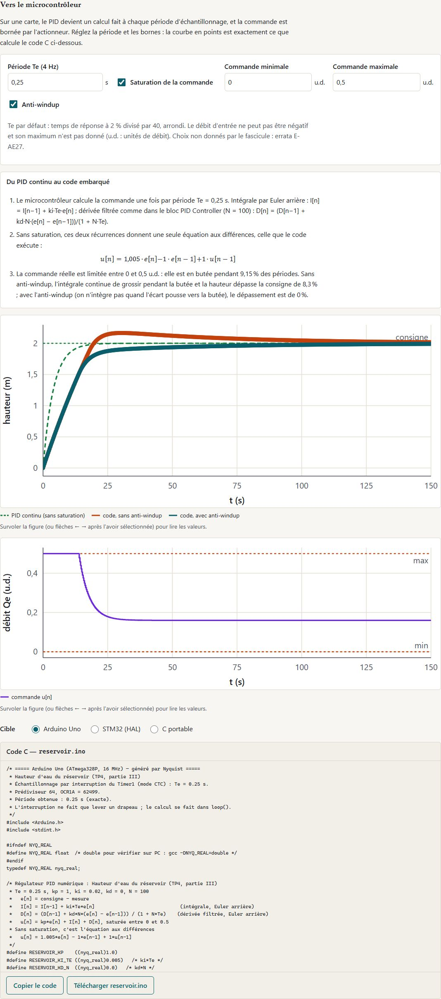
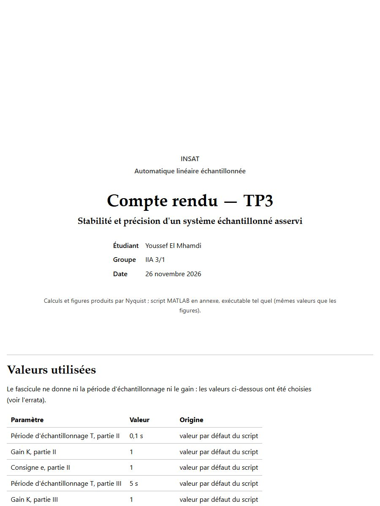
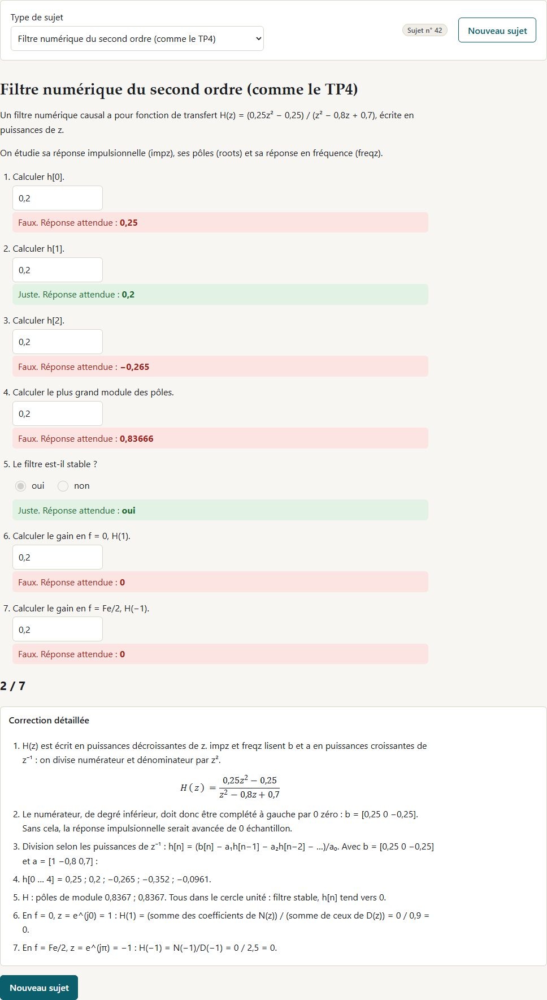

# Nyquist

Interactive companion for the INSAT IIA 3 MATLAB labs:
**Traitement du signal** (TP1–TP4) and **Automatique linéaire échantillonnée** (every TP of the fascicule).

Youssef El Mhamdi, IIA 3/1, INSAT. MIT License.

[](https://github.com/ymhamdi/NYQUIST/actions/workflows/octave-refs.yml)
[](https://github.com/ymhamdi/NYQUIST/actions/workflows/mcu.yml)

> **Status: Phase 4 done.** Every TP with a handout has its interactive page and its compte rendu: Automatique TP1–TP4, Signal TP3–TP4. Also done: Mode DS for both courses, the Simulink model builder, the microcontroller C export, offline use, and the "no hand-typed number" check. Signal TP1–TP2 still wait for their handout. Next: **Phase 5** (deployment, Lighthouse, browser pass, final scorecard). One branch per phase: `phase-0` … `phase-4`.

**Contents:** [What it looks like](#what-it-looks-like) · [Phase 4](#phase-4-every-tp-simulink-builder-microcontroller-export-offline) · [Phase 3: the TP3 page](#phase-3-the-automatique-tp3-page-end-to-end) · [Phase 2: the engine](#phase-2-the-engine) · [Phase 1: the MATLAB scripts](#phase-1-the-matlab-scripts) · [Phase 0](#phase-0-what-was-done) · [Plan and architecture](#the-plan-what-comes-next) · [What I need from you](#what-i-need-from-you) · [Repository layout](#repository-layout)

---

## What it looks like

| | |
|---|---|
|  |  |

**The figure and its explanation follow the sliders** (here the gain K of TP3; the MATLAB cell under each question follows too):


| One question, answer revealed | Vers le microcontrôleur | Compte rendu (A4) | Mode DS |
|---|---|---|---|
|  |  |  |  |

---

## Phase 4: every TP, Simulink builder, microcontroller export, offline

**Pages** (all on the TP3 pattern: predict first, step-by-step derivation, own SVG figures, the script's `%%` cell with the slider values, report):

| Page | What is in it |
|---|---|
| Automatique TP1 | Figure 1.6 redrawn (click a block); the loop the Scope really shows (closed loop, errata E-AE15), linearity. |
| Automatique TP2 | Zero-order hold on a sine (period slider); 9/(s+9) with tf, pole/zero, rlocus, Zero-Pole block, c2d with and without hold; the DC motor (Tableau 2.1, L toggle), its Z-transform, responses with and without hold. |
| Automatique TP4 | Figure 4.1 (PID built from three branches vs the PID Controller block and its filter N); tank and motor, with and without PID; the effect of kp, ki and kd; stepinfo with both MATLAB definitions. |
| Signal TP3 | DFT of x1, x2, x3 (lines, constant, delay), resolution and leakage, zero-padding (statement not verified: no handout). |
| Signal TP4 | tf, roots, zplane, impz (with the z⁻¹ padding derivation), freqz, invfreqz; the second-order IIR low-pass with the printed (unstable) or corrected denominator (statement not verified). |
| Mode DS, Signal | Generated subjects: DFT lines, resolution and zero-padding, second-order filter. 900 subjects are checked against closed forms in the tests. |

A TP switcher sits at the top of every TP page. Every TP page has its compte rendu (`/rapport/...`).

**Simulink, built from code.** [`matlab/simulink/build_models.m`](matlab/simulink/build_models.m) builds the handout's diagrams with `new_system` / `add_block` / `add_line` (figure 1.6, the TP2 hold and motor, figures 3.1, 3.2, 4.1, 4.2, 4.3) with the scripts' default values. It saves them to `build/simulink/`, simulates each one and compares it with `tf` / `step` / `lsim`. Octave has no Simulink, so CI runs it against a **Simulink stand-in** ([`matlab/simulink/test/`](matlab/simulink/test/)). The stand-in checks library paths, parameter names, ports and algebraic loops, then simulates the diagram. **15 signals in 9 models match**, and a flipped sign is caught (mutation test). The real Simulink run is yours to do once (below).

**Vers le microcontrôleur** (Automatique TP4 tank and motor, Signal TP4 filter):
- The PID sampled at Te: backward-Euler integral, filtered derivative, command limits and anti-windup. The loop is drawn with exactly what the C code computes, next to the continuous loop. Example: with a flow limit of 0.5, the tank overshoots by 8.99 % without anti-windup and 0 % with it.
- The filter in floating or fixed point (int16, adjustable fractional bits): quantized coefficients, the poles they give, the frequency response.
- C code for **Arduino Uno** (Timer1 interrupt, prescaler and OCR1A computed, software divider for long periods), **STM32 HAL** (TIM2 callback, PSC/ARR given) or **portable C**, with the difference equation in comments.
- **Proof**, in CI ([mcu.yml](.github/workflows/mcu.yml)): the generated C is compiled with gcc and reproduces the engine **exactly** (8 cases, fixed point included). The STM32 files compile for Cortex-M4 (`-Wdouble-promotion -Werror`), and the sketches compile for the Uno with arduino-cli.

**Offline.** An own service worker (no dependency) precaches the whole site: after one visit, every page, report and Mode DS works with no network (checked in Chrome). Web app manifest and icons included.

**No hand-typed numbers.** [`tools/lint-numbers.mjs`](tools/lint-numbers.mjs) runs in CI and rejects numbers typed in the French prose of the pages and of the errata. The errata's numbers are now computed from the engine and the scripts' defaults (e.g. the motor pole with the printed inductance, −72 704 rad/s).

**Checked, and what the checks caught**
- 130 engine tests pass, and CI is green on every Phase 4 commit (Octave references, Simulink stand-in, microcontroller builds).
- Every page at 375 px: no horizontal scroll, no console error.
- Caught and fixed:
  - the report printed light-grey text when the system was in dark mode (print CSS specificity);
  - a one-sample delay in the first version of the digital-loop simulation;
  - an anti-windup sentence that compared two identical runs;
  - wide tick labels overlapping the y-axis title.

---

## Phase 3: the Automatique TP3 page, end to end

**See it locally:** `npm ci && npm run build && npx astro preview`, then open http://localhost:4321/.

| Page | What it offers |
|---|---|
| `/automatique/tp3/` | Every question with its statement quoted from the fascicule (page number) and its type. **Predict first**: a value or a choice to commit to before the answer appears. The **hand calculation, step by step** with the current numbers (ZOH Z-transform by partial fractions, closed loop, pole, stability, Kmax(T), static error, K for a tolerance). Own SVG figures (hover or arrow keys to read values). The z-plane with the root locus. **Figures 3.1 and 3.2 redrawn**: click a block to see its transfer function. Under each question, the `%%` cell of the script to submit, with the slider values written in (changed lines highlighted), plus copy and download of the full script. |
| `/rapport/automatique/tp3/` | **"Générer le compte rendu"**: cover page (name, group, date), the values used, every question with its answer, derivation and figures at the current values, your observations, and the MATLAB script in annex. A4 PDF with page numbers, via the browser's "Enregistrer en PDF" (17 pages). |
| `/ds/automatique/` | **Mode DS**: three types of generated exercises (sampled loop as in TP3, choice of the sampling period, discretization with and without a hold as in TP2). Auto-corrected by the engine, with the detailed correction. The subject number is in the URL, so a subject can be shared. |
| `/errata/` | The 37 handout issues: what the handout says, the problem, the choice made and why. |

**Measured** (production build, Lighthouse 12, mobile profile with throttling):

| Page | Performance | Accessibility | Best practices | SEO | Transferred |
|---|---|---|---|---|---|
| Home | 100 | 100 | 100 | 100 | 5 KiB |
| TP3 | 100 | 100 | 100 | 100 | 88 KiB (LCP 1.5 s, TBT 50 ms) |
| Report | 99 | 100 | 100 | 100 | 92 KiB |
| Mode DS | 100 | 100 | 100 | 100 | 37 KiB |
| Errata | 100 | 100 | 100 | 100 | 9 KiB |

Desktop, TP3 page: 100 / 100 / 100 / 100. All pages fit a 375 px phone with no horizontal scroll, and show no console errors. The TP page's JavaScript is about 50 KB gzip, and no math or chart library is shipped (native MathML, own SVG).

**Checked, and what the checks caught**
- **The figures, formulas and code follow the sliders.** Moving T moves the question prompts, Kmax (4,083 at T = 0,5 s, as expected) and the URL. A browser test confirms it.
- **A hydration bug, fixed.** With values in the URL, the formulas showed the script's defaults while the text showed the URL's values. Svelte does not repair mismatched `{@html}` on hydration, so the islands now hydrate with the defaults and apply the saved values just after.
- **The derivations and 600 generated exercises agree with the engine** (tests). The engine itself is checked against Octave (Phase 2).


---

## Phase 2: the engine

[`src/engine/`](src/engine/) is plain TypeScript with no dependencies, written from scratch. It is what the website will compute with, so every number on screen will come from here.

| Module | What it does |
|---|---|
| [`poly.ts`](src/engine/poly.ts), [`complex.ts`](src/engine/complex.ts) | Polynomials in MATLAB's order, with roots by Aberth–Ehrlich iteration (exact conjugate pairs, exact roots at 0). |
| [`linalg.ts`](src/engine/linalg.ts) | LU solve, matrix exponential (Padé 6 with scaling and squaring), balancing (LAPACK-style), characteristic polynomial. |
| [`lti.ts`](src/engine/lti.ts) | Transfer functions with MATLAB's semantics: `feedback` keeps cancelled poles, and `pid` builds only the terms that exist. `c2d` by zero-order hold and by impulse invariance, exact step responses, `filter`, `impz`. |
| [`stepinfo.ts`](src/engine/stepinfo.ts) | MATLAB R2021a+ definitions, plus TransientTime (the pre-2021 SettlingTime). |
| [`dsp.ts`](src/engine/dsp.ts) | FFT of any length (radix-2, or Bluestein otherwise), `fftshift` axes, DTFT, `freqz`, `conv`, circular convolution. |
| [`matlabScript.ts`](src/engine/matlabScript.ts) | Reads the TP scripts themselves: the `%%` cells and the `@param` lines (value, unit, range or choices). `substitute` rewrites values; this is what makes the shown code follow the sliders. |
| [`tp/`](src/engine/tp/) | One model per TP script. Each mirrors its script **cell by cell, with the script's variable names**. |

**How it is proven: 120 tests, in three layers**
1. **Engine vs Octave at the scripts' defaults** ([tests/reference/](tests/reference/)). Every cell of every script is compared with `reference/*.json` at 10⁻⁹. Each cell must compare a minimum number of variables, so a renamed variable cannot skip its check. A meta-test changes T by 0.1 % and checks that the comparison **fails**.
2. **Engine vs closed forms** ([tests/engine/core.test.ts](tests/engine/core.test.ts)), independent of Octave so that a mistake shared by both cannot hide. It covers the FFT against the DFT definition for N = 8, 50, 64, 100, 101, ZOH and impulse discretization, the matrix exponential, the root finder, `stepinfo`, and the script parser.
3. **"The code follows the sliders"** ([tests/sliders/](tests/sliders/)). Random slider positions are drawn within each `@param` range and written into copies of the scripts with the same `substitute` the site uses. GNU Octave runs them, and the engine must reproduce every result at those positions. CI runs 36 random positions on every push; I ran 60 locally.

**What the random-slider test caught** (all fixed)
- **A bug in the TP4 script.** For a setpoint below 1.6 m, the tank never overflows, but the script computed the overflow time with the log of a negative number. MATLAB and Octave silently return a **complex** time (45.4 − 157.1j s). The script now returns Inf in that case.
- **An engine crash.** With the printed L = 0.011 mH, `stepinfo` simulates 400,001 points, and `Math.max(...array)` overflowed the call stack. It would have frozen the page.
- **Two engine accuracy issues with the stiff motor** (poles −22.9 and −72,700 rad/s). The companion-form realization was ill-conditioned until it was balanced. A pole mapped to e^{−3155} = 0 left an exact z/z factor that Octave cancels.
- **Two behaviours to match MATLAB.** `pid(kp, 0, 0)` is a plain gain, not 2s/s with a spurious pole at 0. The derivative filter Tf disappears when kd = 0.

---

## Phase 1: the MATLAB scripts

These are the files to submit. Open one in MATLAB and run it cell by cell (Ctrl+Enter), or all at once (F5).

| Script | Cells (handout numbering) |
|---|---|
| [automatique/tp1_simulink_premier_ordre.m](matlab/automatique/tp1_simulink_premier_ordre.m) | III.1, III.2 |
| [automatique/tp2_discretisation.m](matlab/automatique/tp2_discretisation.m) | II.1–II.2, III.1–III.6, IV.1–IV.4 |
| [automatique/tp3_stabilite_precision.m](matlab/automatique/tp3_stabilite_precision.m) | II.3–II.7, III.1–III.6 |
| [automatique/tp4_regulation_pid.m](matlab/automatique/tp4_regulation_pid.m) | III.1–III.4, IV.5–IV.8 |
| [signal/tp3_tfd.m](matlab/signal/tp3_tfd.m) *(statement not verified)* | Q1–Q12 |
| [signal/tp4_filtres_numeriques.m](matlab/signal/tp4_filtres_numeriques.m) *(statement not verified)* | I.1–I.5, invfreqz (outside the handout), II.1–II.3 |

**How each script is written**
- French comments that give the reasoning and the hand calculation (for example G(z) = (1 − a)/(z − a) with a = e^{−T}). MATLAB's result is checked against the hand result in the same cell.
- Every value the handout leaves open is on a line tagged `% @param` and explained: T = τ/10, K = 1, the 2 % tolerance, Cr = 0, L = 0.011 H… These are the lines the website's sliders will rewrite (Phase 3).
- Defaults are computed, not guessed. The "réponse désirée" of TP4 is a stated spec (overshoot ≤ 5 %, zero static error), and both default tunings meet it. Tank: PI kp = 1, ki = 0.02, which cancels the plant pole (0 % overshoot, Ts = 15.6 s). Motor: PID kp = 2, ki = 60, kd = 0.02 (1.8 % overshoot, Ts = 0.086 s).

**How correctness is proven**
- [`matlab/refs/export_refs.m`](matlab/refs/export_refs.m) runs every script in GNU Octave **cell by cell**. For each question it records every variable the cell creates and writes it to [`reference/*.json`](reference/). This takes about 15 s for all six scripts.
- The [CI job](.github/workflows/octave-refs.yml) re-runs the scripts on every push and [compares](tools/compare-refs.mjs) the result with the committed JSON (relative tolerance 1e-9). A script changed without regenerating its references turns CI red. The comparator was tested both ways: it passes on a fresh run and catches a 10⁻⁶ change.
- 38 key results were checked against closed forms computed independently, for example Kmax(0.1 s) = (1 + e^{−0.1})/(1 − e^{−0.1}) = 20.0167, the tank's settling time τ·ln 50, and the DFT line 150 = N·A/2. All 38 match.
- Every Octave/MATLAB difference found is documented in [matlab/OCTAVE_VS_MATLAB.md](matlab/OCTAVE_VS_MATLAB.md). Octave lacks `stepinfo` and `order`, so `matlab/compat/` has shims that MATLAB never sees. Octave's `lsim` interpolates steps linearly, so the scripts avoid relying on it. One point needs **one line run in MATLAB**: the `'impulse'` method of `c2d`.

**What running them found** (now in the scripts' comments and the errata)
- With the default T = 5 s, the tank **cannot** reach 2 m within 2 % with a P controller. It needs K ≥ 3.92 but Kmax(5 s) = 1.60, so T must be below 2.04 s. The script computes this.
- In Signal TP3, zero-padding moves the peak toward the continuous spectrum's peak (107.9 Hz), **not** toward 105 Hz. With 50 samples, the DC component's lobe biases it.
- Signal TP3 Q8 compares signals of amplitudes 1 and 3 (new errata E-TS10).

---

## Phase 0: what was done

### 1. Inventory of every handout question → [COVERAGE.md](COVERAGE.md)

Each known question is listed with its handout number, its exact statement (typos included), its type (calcul à la main / MATLAB / Simulink / interprétation) and the handout page it comes from. Nothing is guessed: anything without a source is marked **needs handout**.

| Course | TP | Questions | Source |
|---|---|---|---|
| Automatique | TP1 Initialisation à Matlab Simulink | **III.1–III.2** | ✅ checked against the PDF (p. 5–9) |
| | TP2 Discrétisation d'un signal à temps continu | **II.1–2, III.1–6, IV.1–4** + Tableau 2.1 | ✅ checked against the PDF (p. 10–11) |
| | TP3 Stabilité et précision d'un système échantillonné asservi | **II.3–II.7, III.1–III.6** (the handout's numbering really starts at 3) | ✅ checked against the PDF (p. 13–15) |
| | TP4 Asservissement des systèmes continus | **III.1–III.4, IV.5–IV.8** + Tableau 4.1 | ✅ checked against the PDF (p. 16–18) |
| Traitement du signal | TP1 Signaux discrets | Outline only (1.1, 1.2, 1.3) | ⏳ exact statements and numbering need the PDF |
| | TP2 Convolution | Outline only (parts A and B) | ⏳ exact statements and numbering need the PDF |
| | TP3 TFD | 2.1 + **Q1–Q12** (p. 5) | ⏳ second-hand; §1 missing |
| | TP4 Filtres numériques | **I.1–I.5, II.1–II.3** (p. 6) | ⏳ second-hand; full "programme fourni" missing |

The Automatique fascicule has **exactly 4 TPs and 33 questions**, 18 of them involving Simulink.

### 2. Errata du fascicule: 37 issues found → [COVERAGE.md, last section](COVERAGE.md#missing-values-and-inconsistencies-feed-the-errata-du-fascicule-page)

These will become a visible *Errata* page in the app. For each issue it gives what the handout says, why it is a problem, the choice made and why. The choice is always exposed as a slider or toggle. The most important ones:

- **The sampling period T is never given**, neither in Automatique TP2 nor in TP3, yet every result depends on it (G(z), Kmax, stability). → slider, default from the rule T ≈ τ/10, and the Kmax(T) curve always shown.
- **"K pour remplir 2 m"** (TP3 III.4): a proportional controller never reaches exactly 2 m, and no tolerance is given. → tolerance slider plus the derivation K ≥ (1−ε)/(12.5ε), checked against Kmax(T).
- **The same motor has two inductances**: Tableau 2.1 (TP2) says L = 0.011 **H**, Tableau 4.1 (TP4) says 0.011 **mH**. With 0.011 mH the electrical pole lands near −72 700 rad/s, which is implausible. → proposed default 0.011 H, with a toggle to the printed value (your decision).
- **TP2's mechanical equation has a sign error**: « JsΩ − kcI − Cr − fΩ = 0 » contradicts its own eq. (2), Ω = (kcI − Cr)/(Js+f). → eq. (2) is used.
- **TP2 asks for a command 'imp' that does not exist**. The most likely meaning is `c2d(G, T, 'impulse')`, i.e. discretization *without* a hold, compared with `'zoh'`. → both derived and compared.
- **TP2 says "sinusoïdal de fréquence 1 rad/sec"**: rad/s is a pulsation (ω = 1 rad/s, f ≈ 0.159 Hz). **TP1 writes "G(p) = 9/(s+9)"**, and its Figure 1.6 actually closes the loop, so the scope shows 9/(s+18) settling at 0.5.
- **Units**: f is printed "N.m" (should be N·m·s/rad); the motor setpoint is "10 V" in the table but "10 rad/s" in the text; the tank setpoint is labelled Qe (an inflow) while it is compared with a height.
- **The PID in Simulink ≠ `pid()` in MATLAB**: the Simulink `PID Controller` block filters the derivative (N = 100 by default), so the curves differ as soon as kd ≠ 0. → both modelled and compared.
- **`stepinfo` changed definition in MATLAB R2021a** (settling band measured against |y_final − y_init| instead of the peak error). → both implemented; the version is named on screen.
- **The IIR filter of Signal TP4 is unstable as printed** (denominator 0.516z² − 1.2z + 1: |poles| = 1.392, in z or in z⁻¹). It is z² − 1.2z + 0.516 with its coefficients reversed; reversing them inverts the poles (|p| = 0.718). → use the stable one and show the printed one as an errata toggle.
- **The program given in Signal TP4** uses `freqz(Num, Den, 1/Te)`, where 100 is read as a *number of points*, not a frequency. A numerator written in powers of z must be left-padded for `impz`/`freqz`.
- Ambiguities to settle with the PDF: sine or cosine in Signal TP1 1.2 (at fe = 2f₀ a sine gives only zeros, a cosine gives ±1); the meaning of "fréquence de Nyquist" (fe/2 or 2·fmax); N = 100 or 101 samples in Signal TP3 Q1.

### 3. The tool chain was set up and validated

- **GNU Octave in Docker** ([docker/octave.Dockerfile](docker/octave.Dockerfile)): Ubuntu 24.04, Octave 8.4.0, control 4.0.1, signal 1.4.5. It is the same environment the CI will use to generate every reference value.
- **Headless figures work.** It took two discoveries: Octave needs the `fonts-freefont-otf` package (otherwise "invalid bounding box, cannot render"), and `gnuplot` or `xvfb` to draw without a screen.
- **Octave vs MATLAB differences found so far.** `stepinfo`, `order`, `xline` and `yline` do not exist in Octave, and Octave cannot call local functions placed at the end of a script. → Octave-only shims in `matlab/compat/`. The submitted scripts stay pure MATLAB.
- **MATLAB's exact `stepinfo` definitions** were checked in the MathWorks documentation (R2021a+ and R2020b).
- **The Python "Run" button is feasible.** Pyodide 0.27.7 loads python-control 0.10.2 in the browser, and its results match Octave: c2d of 1/(s+1) at T = 0.1 s gives 0.09516/(z − 0.90484), and the tank's PI loop gives a 3.888 % overshoot. Its weak point is size (≈ 45 MB), so it will be an opt-in button. One quirk: `step_info` needs an explicit time vector.
- **Measurement scripts** in [tools/](tools/): a Lighthouse batch runner and a phone (375 px) / offline probe. They will check the performance and accessibility targets.

### 4. The stack was chosen → [PLAN.md §1](PLAN.md#1-stack-chosen-on-its-merits)

---

## The plan: what comes next

Full details: [PLAN.md](PLAN.md).

### Priorities (in this order)
1. **Complete coverage**: every question of every TP, with the handout's numbering. Nothing left "à venir".
2. **Proven correctness**: one clean MATLAB script per TP (one `%%` cell per question, French comments) is the source of truth. A GitHub Actions job runs them in Octave and writes every reference number to JSON, and the web engine's tests compare against that JSON. No hand-typed values.
3. **Code that follows the sliders**: the MATLAB shown is the submitted script's cell with the current slider values, so pasting it into MATLAB reproduces the plot on screen. CI proves it by running the substituted cells in Octave.
4. **Learning**: "predict first" on every question, step-by-step hand derivations, and a **Mode DS** of generated exercises with auto-correction and a full correction.
5. **The deliverable**: a "Générer le compte rendu" button per TP: cover page, Q&A, derivations, figures at the current parameters, observations, MATLAB annex, A4 PDF.
6. **Industrial side**: the Simulink models built from code; "Vers le microcontrôleur" C export for Arduino/STM32, compiled in CI.
7. **Polish**: Lighthouse ≥ 95, offline, phone, keyboard, dark/light themes, SVG figures with clickable blocks, the Errata page, this README.

### Stack (as built)
| Part | Choice | Why |
|---|---|---|
| Pages | **Astro 7** (static) | Pre-rendered HTML: fast even on a phone; only the interactive parts load JavaScript |
| Interactive parts | **Svelte 5** islands | Tiny runtime; one slider updates figure, formula, code and derivation at once |
| Figures | **Own SVG plotting module** | No chart library to download; crisp in the PDF report; follows the theme |
| Formulas | **Native MathML** from an own builder | Nothing to download; selectable and accessible |
| Engine | **TypeScript, no dependencies** | Tested against the Octave JSON; shared by pages, exercises, report and C export |
| Offline | **Own service worker** generated at build time | The available PWA plugin for Astro 7 depended on a days-old 0.0.x core; ours is ~70 lines |
| Tests | **Vitest**, Octave in CI, gcc / arm-none-eabi-gcc / arduino-cli in CI, Chrome checks | Numbers, wiring, generated C, phone, offline |

### Architecture
```
matlab/                 source of truth: the TP scripts to submit
  automatique/, signal/ one script per TP, one %% cell per handout question, @param lines = the sliders
  simulink/             build_models.m (Simulink from code) + test/ (Octave stand-in for Simulink)
  compat/, refs/        Octave shims (stepinfo, order) and the reference exporter
reference/              JSON written by Octave in CI from the scripts; never edited by hand
src/engine/             computations: poly, linalg, lti, stepinfo, dsp, mcu (digital PID, fixed point),
                        codegen (C), matlabScript (reads the @param lines), tp/ (one model per script)
src/derive/             step-by-step hand derivations, with the current numbers
src/exercises/          Mode DS generators (Automatique, Signal)
src/content/            handout statements (verbatim, with page), errata, TP lists, defaults
src/components/, src/pages/, src/layouts/   Svelte islands and Astro pages
tests/                  engine vs Octave, vs closed forms, random slider positions, exercises, C code
tools/                  reference comparator, number lint, C check, service worker, Lighthouse runner
```
**Data flow.** A TP page reads its script (`?raw` import) and parses the `@param` lines into sliders. The engine model of that script runs on the slider values. Every view reads its result: figure, formula, derivation, prediction, MATLAB cell (the script with the values written in), report, C code. CI closes the loop. It runs the same scripts in Octave, at the defaults and at random slider positions, and requires the engine to match.

### Phases
| Phase | Content | Status |
|---|---|---|
| **0** ✅ | Audit, coverage, errata, plan | done |
| **1** ✅ | MATLAB scripts, Octave shims, the CI job that writes `reference/*.json` | done |
| **2** ✅ | Engine, tests against the JSON, "code follows sliders" check in CI | done |
| **3** ✅ | Automatique TP3 end to end, reviewed | done |
| **4** ✅ | Automatique TP1, TP2, TP4 and Signal TP3, TP4 pages and reports; Mode DS Signal; Simulink builder; C export; offline; number lint; README | done |
| **5** | Deploy to GitHub Pages (the repo becomes public: I will ask you first), Lighthouse on every page, desktop and phone pass, originality check, final scorecard | next |

Cut from the plan, as foreseen (bottom of the priority list): the in-browser Python "Run" button (Pyodide, ≈ 45 MB). The MATLAB cells are already exact and copyable.

**Known limit.** On Automatique TP4, switching to the printed inductance (0.011 mH) takes about 0.9 s. The motor is then very stiff, and stepinfo uses the same fine grid as the Octave references.

---

## What I need from you
1. **Run two things once in MATLAB at school** (Octave cannot check them):
   - `build_models` in `matlab/simulink/`: it builds the 9 Simulink models, simulates them and prints a table. Every line should say `OK`. If one says `ÉCART`, send me the table.
   - The one-line `c2d(…, 'impulse')` check of [matlab/OCTAVE_VS_MATLAB.md](matlab/OCTAVE_VS_MATLAB.md) (TP2 III.6).
2. **The *Traitement du signal* handout PDF**, if you ever get it. Signal TP1/TP2 stay "needs handout"; TP3/TP4 rest on an unverified transcription. Put it in [handouts/](handouts/) (git-ignored).
3. **Phase 5:** I will ask you before making the repository public for GitHub Pages.

## Repository layout
| Path | Content |
|---|---|
| [matlab/](matlab/) | The TP scripts (submitted), the Simulink builder (`simulink/`), the Octave shims (`compat/`), the reference exporter (`refs/`), [OCTAVE_VS_MATLAB.md](matlab/OCTAVE_VS_MATLAB.md) |
| [reference/](reference/) | Reference values generated by Octave from the scripts, per question. Never edited by hand. |
| [src/](src/) | The site: engine, derivations, exercises, content, components, pages |
| [tests/](tests/) | Engine vs Octave references, vs closed forms, random slider positions, exercises, generated C (`npm test`) |
| [tools/](tools/) | Reference comparator, number lint, C check, service worker, Lighthouse batch runner, phone/offline probe |
| [docs/screenshots/](docs/screenshots/) | The images of this README |
| [COVERAGE.md](COVERAGE.md) | Every handout question, its source, type and status, plus the errata list |
| [PLAN.md](PLAN.md) | Stack, architecture, requirements → design → targets, phases, cut order |
| [CLAUDE.md](CLAUDE.md) | Conventions, commands and decisions, for continuing the work |
| [docker/octave.Dockerfile](docker/octave.Dockerfile) | Local copy of the CI Octave environment |
| [handouts/](handouts/) | Where the handout PDFs go (kept local, git-ignored) |

### Run the site
```bash
npm ci
npm run dev          # http://localhost:4321
npm test             # engine, exercises, generated C cases
npm run lint:numbers # no hand-typed number in the prose
npm run build && npm run preview
```

### Run the scripts in Octave and regenerate the references
```bash
docker build -t nyq-octave -f docker/octave.Dockerfile docker/
docker run --rm -v "$PWD:/w" -w /w nyq-octave octave-cli --eval "addpath('matlab/refs'); export_refs"
node tools/compare-refs.mjs reference regenerated   # what CI does, after export_refs('regenerated')
```
(On Windows Git Bash, prefix with `MSYS_NO_PATHCONV=1` and use a `C:/...` path for `-v`.) To use the scripts in your own Octave, run `matlab/octave_setup.m` once.
