<div align="center">

# Nyquist

### Move the slider. The MATLAB follows. Octave checks.

An interactive companion for the INSAT IIA 3 MATLAB labs, *Traitement du signal* and *Automatique linéaire échantillonnée*. Each handout question comes with a prediction to commit to, the hand calculation with your numbers, the figures, and the cell of the MATLAB script you submit, rewritten with your slider values. Every number on screen comes from one engine, and CI checks that engine against GNU Octave running the same scripts.

**Youssef El Mhamdi · IIA 3/1 · INSAT**

[Quick start](#quick-start) · [Try it in 5 minutes](#try-it-in-5-minutes) · [Labelled honestly](#labelled-honestly) · [Where every number comes from](docs/readme-facts.md) · [Build history](docs/overview.md)

[](https://github.com/ymhamdi/NYQUIST/actions/workflows/octave-refs.yml)
[](https://github.com/ymhamdi/NYQUIST/actions/workflows/mcu.yml)

</div>

<p align="center">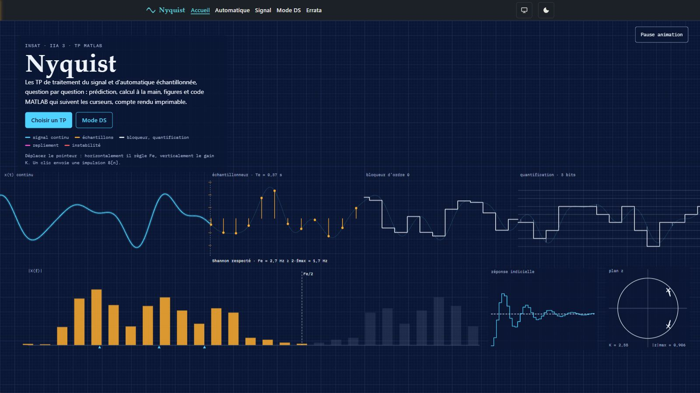</p>

<p align="center">
<b>33</b> Automatique questions, checked against the handout ·
<b>60</b> script cells where the engine matches Octave ·
<b>36</b> random slider positions re-run in Octave on every push ·
<b>38</b> handout errata ·
<b>8</b> generated C programs that match the engine exactly ·
<b>0</b> hand-typed numbers in the French prose
</p>
<p align="center"><sub>Every number on this page has a source in <a href="docs/readme-facts.md"><code>docs/readme-facts.md</code></a>. The other side of these numbers: Signal TP1–TP2 have no page (no handout), the Signal TP3–TP4 statements are not verified, and two checks still need a run in real MATLAB.</sub></p>

---

## The handout asks for Kmax. It never gives T.

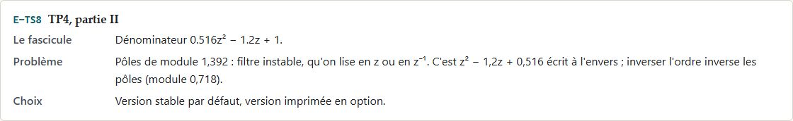

Question 7 of Automatique TP3 asks you to « indiquer la valeur limite de K ». That limit depends on the sampling period T, and the fascicule never gives T. Signal TP4 prints a low-pass filter whose poles have modulus 1,392: unstable as printed. TP2 asks for a command 'imp' that MATLAB does not have.

You usually find this out while writing the compte rendu.

<br clear="right">

### Now imagine a TP sheet that answers back.

- Every question, its statement quoted word for word from the handout.
- A prediction to commit to before the answer appears.
- The hand calculation, step by step, with the numbers you chose.
- The cell of the script to submit, rewritten with your slider values, and a compte rendu that prints to A4.

**That is Nyquist. And every number in it has been through Octave.**

---

## 01 · Move a slider. Everything follows.

The gain K of question 6 (Automatique TP3) is a slider. Move it and the sentence under the question, the response and the MATLAB cell follow. Here K goes from 1 to 8 and back:

<p align="center">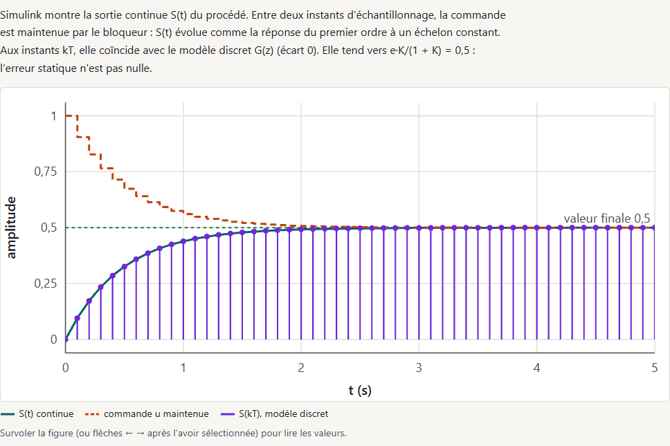</p>

The sliders are not a separate model. They are the `% @param` lines of the scripts themselves (42 of them across the 6 scripts), and the engine mirrors each script cell by cell, with the same variable names:

<p align="center">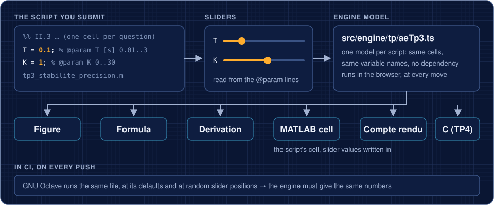</p>

So the cell shown under a question is the submitted script's own cell, with your values written in, ready to paste into MATLAB. CI runs such substituted cells in Octave and checks that they give the numbers on screen.

---

## 02 · Predict first. Then the derivation.

<table>
<tr>
<td width="50%" valign="top">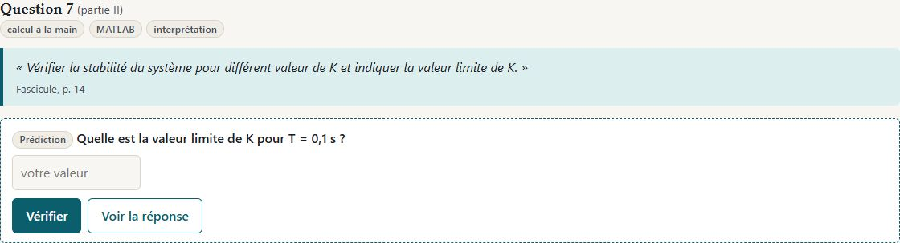<br><b>Before</b><br><sub>The statement, word for word with its page, then a prediction to commit to: a value or a choice.</sub></td>
<td width="50%" valign="top">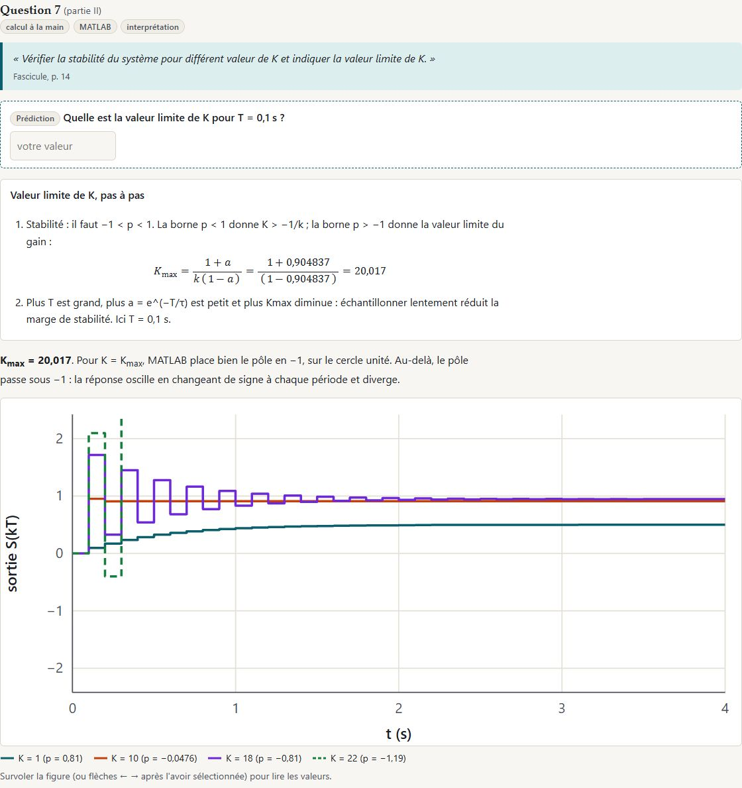<br><b>After</b><br><sub>The hand calculation with the current numbers (here Kmax = 20,017 at T = 0,1 s), the responses on each side of the limit, and Kmax(T).</sub></td>
</tr>
</table>

Each page covers every question of its TP, in the handout's numbering: the 33 questions of the Automatique fascicule (TP1 2, TP2 12, TP3 11, TP4 8) and the 20 transcribed questions of Signal TP3–TP4.

---

## 03 · One script. Checked by Octave.

The MATLAB scripts in [`matlab/`](matlab/) are the source of truth. No reference value is typed by hand: Octave writes them, and the engine must match.

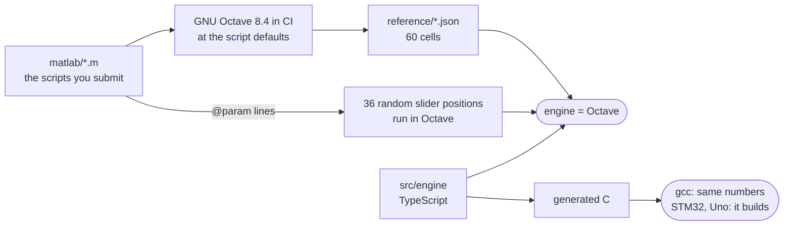

| Check (CI on `main`) | Result on 26 Nov 2026 |
|---|---|
| Committed references vs a fresh Octave run ([`compare-refs.mjs`](tools/compare-refs.mjs)) | 6 files match (rel 1e-9, abs 1e-12) |
| Engine vs references (rel 1e-9; 1e-6 for values read off a simulated response), closed forms, derivations, Mode DS ([`tests/`](tests/)) | 130 passed, 2 skipped |
| Random slider positions: written by the site's own `substitute`, run in Octave | 36 positions; engine matched (38 passed, 1 skipped) |
| The comparison can fail: T moved by 0.1 % must be caught ([`aeTp3.test.ts`](tests/reference/aeTp3.test.ts)) | caught |
| Simulink diagrams built from code, run in a Simulink stand-in ([`check_models.m`](matlab/simulink/test/check_models.m)) | 15 signals in 9 models match |
| No number typed in the French prose ([`lint-numbers.mjs`](tools/lint-numbers.mjs)) | 0 found |
| Generated C, compiled with gcc in double ([`check-c.mjs`](tools/check-c.mjs)) | 8 programs reproduce the engine exactly |

Not checked by any machine yet: the real Simulink run of [`build_models.m`](matlab/simulink/build_models.m), and how MATLAB scales `c2d(…, 'impulse')`. Both are one command to run in MATLAB ([`OCTAVE_VS_MATLAB.md`](matlab/OCTAVE_VS_MATLAB.md)).

The random-slider test earned its place. It found a script bug: in Automatique TP4, below a 1.6 m setpoint, the tank's overflow time was the log of a negative number, and MATLAB and Octave both returned a complex time. The script now returns `Inf`.

---

## 04 · The handout, read closely.

The « Errata » page lists 38 issues ([`src/content/errata.ts`](src/content/errata.ts)): 27 in the Automatique fascicule, 11 in the Signal transcription. Each gives what the handout says, the problem, and the choice made. Where the handout leaves a value open, the choice is a slider or a toggle on the TP page, never a silent fix.

<table>
<tr>
<td width="50%" valign="top">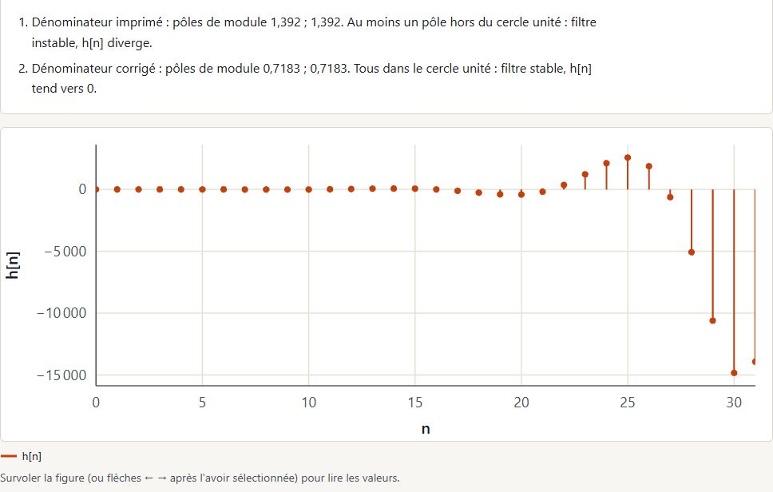<br><b>As printed</b><br><sub>« Dénominateur du filtre » set to « imprimé »: poles of modulus 1,392, h[n] diverges.</sub></td>
<td width="50%" valign="top">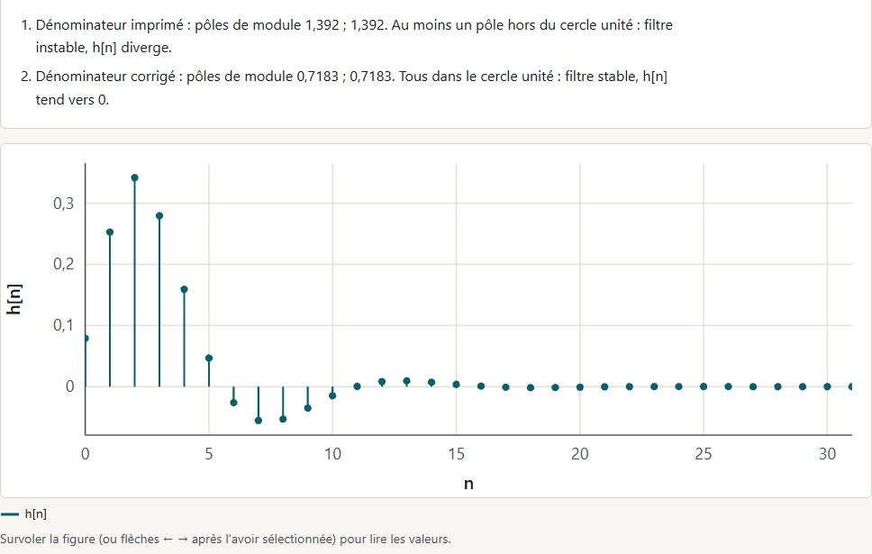<br><b>Corrected (default)</b><br><sub>The same coefficients in the other order: poles of modulus 0,7183, h[n] tends to 0.</sub></td>
</tr>
</table>

| The handout… | Nyquist | Errata |
|---|---|---|
| never gives the sampling period T (TP2, TP3) | slider; default τ/10, rounded down to the 1–2–2.5–5 series; Kmax(T) always shown | E-AE1, E-AE17 |
| asks for « la valeur de K pour remplir 2m » with no tolerance | tolerance slider, and K ≥ (1 − ε)/(12.5ε) compared with Kmax(T) | E-AE6 |
| gives the same motor two inductances, 0.011 H and 0.011 mH | 0.011 H by default, the printed value as a toggle | E-AE7 |
| asks for a command 'imp' | `c2d(G, T, 'impulse')` against `'zoh'`, both derived | E-AE20 |
| asks for a « réponse désirée » without saying which | stated spec: overshoot ≤ 5 %, zero static error | E-AE10 |
| prints an unstable low-pass filter | stable version by default, printed one as an option | E-TS8 |

---

## 05 · From the TP to the board.

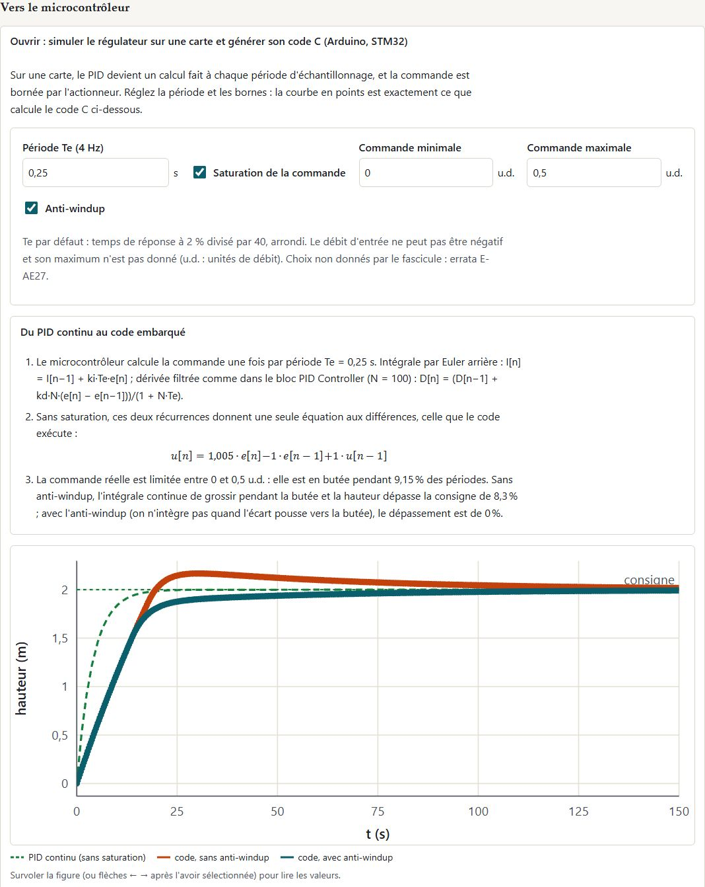

On a board, the PID becomes a calculation done once per sampling period, with a command the actuator bounds. The « Vers le microcontrôleur » panels of Automatique TP4 (tank, motor) and Signal TP4 (the filter) show exactly that:

- backward-Euler integral and a derivative filtered as in the Simulink PID Controller block (N = 100);
- command limits and anti-windup. With the tank's inflow limited to 0,5 (the handout gives no limit: errata E-AE27), the height overshoots the 2 m setpoint by 8,3 % without anti-windup and 0 % with it;
- the filter in floating or fixed point, with the quantized coefficients and the poles they give.

The plotted points are what the C code computes. The code is generated for three targets, and CI builds each one:

| Target | Generated | Checked in CI |
|---|---|---|
| Portable C | the difference equation, as a plain C function | gcc, in double: same numbers as the engine; fixed point: identical integers |
| STM32 (HAL) | TIM callback, PSC and ARR given | `arm-none-eabi-gcc` Cortex-M4, `-Werror -Wdouble-promotion` |
| Arduino Uno | Timer1 interrupt, prescaler and OCR1A computed | `arduino-cli`: 1 706 to 2 642 bytes of 32 256 |

No generated program has run on a physical board yet.

<br clear="right">

---

## 06 · Report, exam, projector.

<table>
<tr>
<td width="50%" valign="top">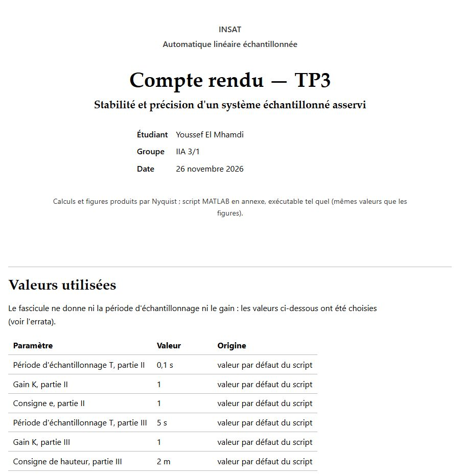<br><b>« Générer le compte rendu »</b><br><sub>Cover, the values used, every question with its answer, derivation and figures at your values, your observations, the script in annex. A4 through the browser's « Enregistrer en PDF ».</sub></td>
<td width="50%" valign="top">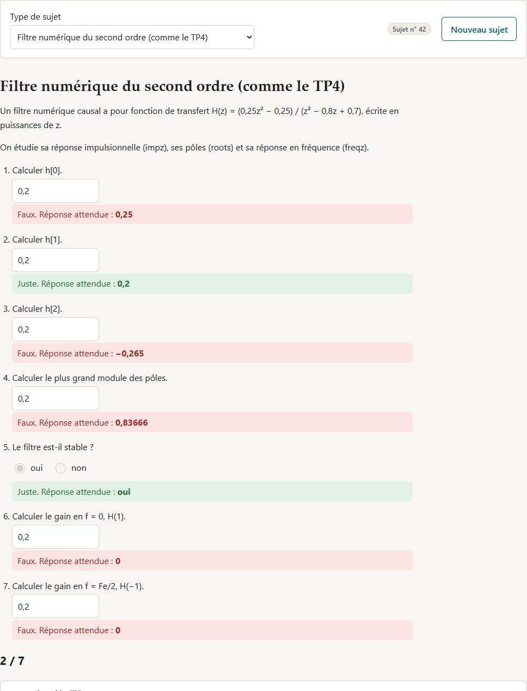<br><b>Mode DS</b><br><sub>Generated subjects, three kinds per course, corrected with the full derivation. The subject number sits in the URL. The tests check 1 500 subjects against the hand derivations.</sub></td>
</tr>
<tr>
<td width="50%" valign="top">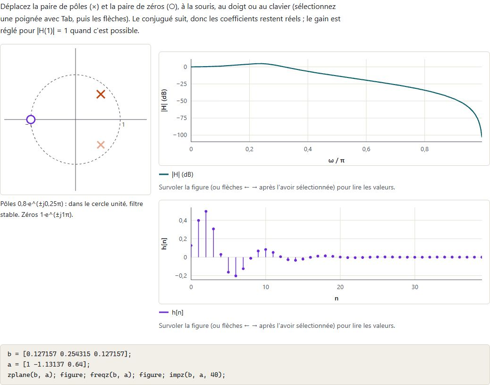<br><b>Pole/zero explorer</b> (Signal TP4)<br><sub>Drag a pair of poles and a pair of zeros, with the pointer or the keyboard; the responses and the MATLAB coefficients follow.</sub></td>
<td width="50%" valign="top">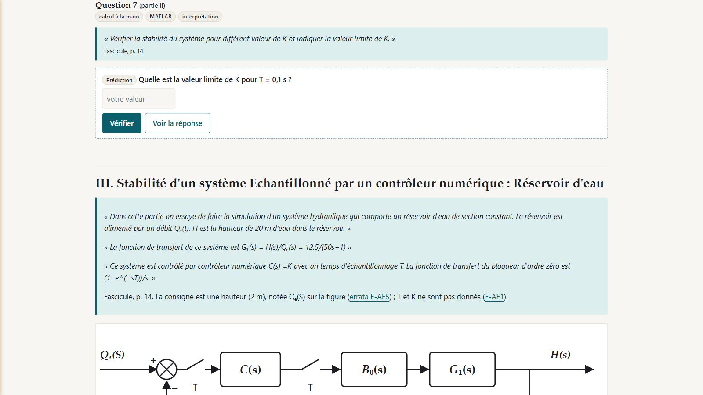<br><b>Mode projection</b><br><sub>For a projector in class: larger type, full contrast, no navigation. The screen button in the header, or the P key.</sub></td>
</tr>
</table>

---

## 07 · A sampling chain you can touch.

The home page is the course in one picture. The pointer's x sets the sampling frequency Fe, its y the loop gain K, and a click sends δ[n]. Every curve comes from the same engine as the TP pages: FFT, `c2d` with a hold, `feedback`, poles.

<table>
<tr>
<td width="33%" valign="top">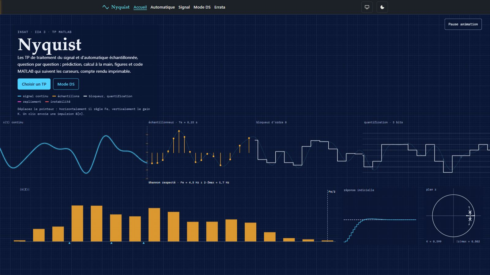<br><b>« Shannon respecté »</b><br><sub>Fe = 4,3 Hz ≥ 2·fmax = 1,7 Hz.</sub></td>
<td width="33%" valign="top">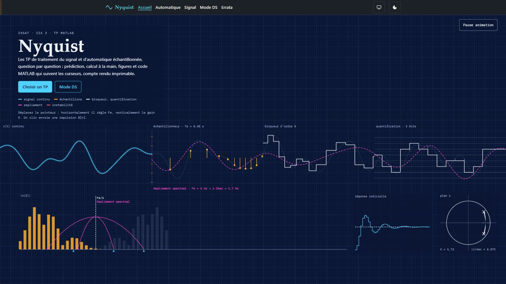<br><b>« Repliement spectral »</b><br><sub>Fe = 1 Hz &lt; 1,7 Hz: in magenta, the wrong signal through the same samples.</sub></td>
<td width="33%" valign="top">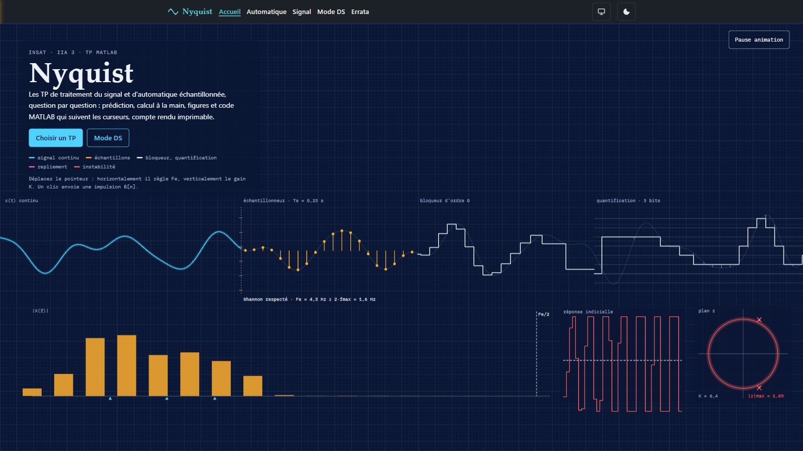<br><b>Unstable loop</b><br><sub>K = 6,4: |z|max = 1,09, in red.</sub></td>
</tr>
</table>

The whole home page loads 9.9 KiB of JavaScript (gzip), scene included. It pauses off screen, keeps a « Pause animation » button, and shows a single still frame when the system asks for reduced motion. The course pages use a calmer version above their TP cards.

<p align="center">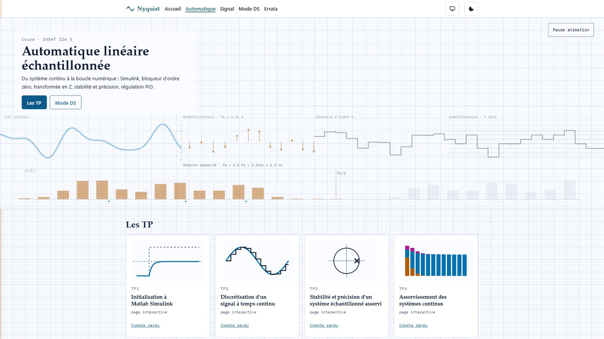</p>

---

## 08 · Light, fast, offline.

**Lighthouse 12** on all 18 pages (local production build, one run per page, 26 Nov 2026):

| Profile | Performance | Accessibility | Best practices | SEO |
|---|---|---|---|---|
| Mobile (simulated slow 4G, 4× CPU) | 95–100: 100 on 8 pages, lowest 95 (comptes rendus of Automatique TP2 and TP4) | 100 | 100 | 100 |
| Desktop | 100 | 100 | 100 | 100 |

- **No chart or math library shipped.** Own SVG plots and native MathML. JavaScript per page: 0 to 69.9 KiB gzip, under a 70 KiB limit that CI enforces. The 60 KiB target is met by 14 of the 18 pages.
- **Offline.** An own service worker precaches the 87 files of the site: after one visit, the pages, reports and Mode DS load without a network (checked in Chrome on 26 Nov).
- **Phone, keyboard, themes.** Light and dark themes, keyboard access to the sliders and figures, layouts down to phone width.

<table>
<tr>
<td width="25%" valign="top">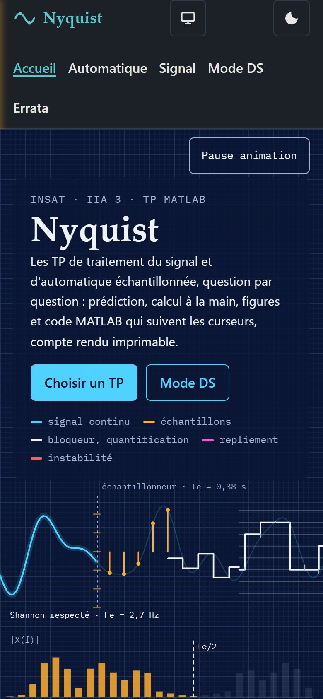<br><sub>Phone, dark</sub></td>
<td width="25%" valign="top">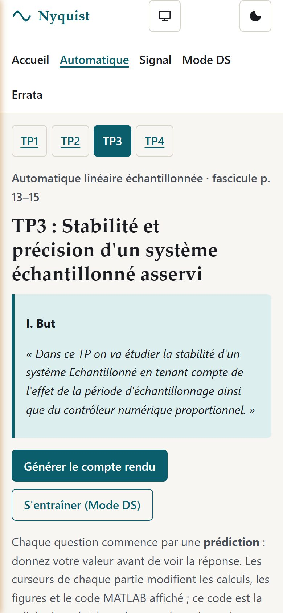<br><sub>Phone, light</sub></td>
<td width="50%" valign="top">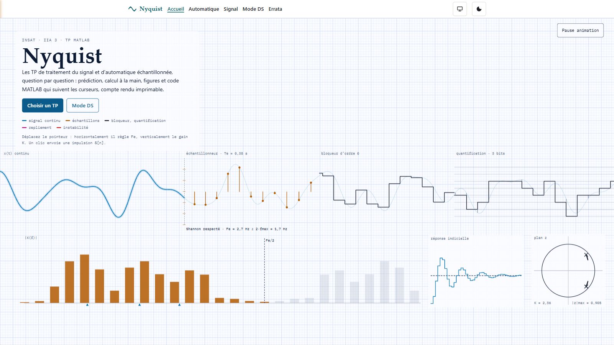<br>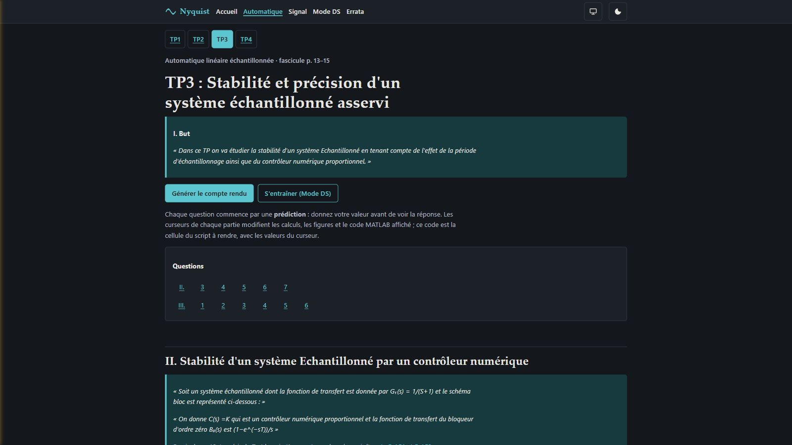<br><sub>Desktop, light home page and dark TP page</sub></td>
</tr>
</table>

---

## Quick start

Needs Node.js (CI uses version 24).

```bash
npm ci
npm run dev          # http://localhost:4321
```

The production build, as measured above: `npm run build && npm run preview`.

### Try it in 5 minutes

1. On the home page, move the pointer to the left edge: Fe drops below 2·fmax and the magenta « Repliement spectral » appears. Move it up: K grows until the z-plane turns red.
2. « Choisir un TP » → Automatique **TP3**. In question 7, type your guess for the limit of K, then « Vérifier ».
3. In part II, move the slider « Gain du contrôleur K »: the figures and the MATLAB cells follow. « Copier la cellule », then paste it into MATLAB.
4. « Générer le compte rendu », then print and choose « Enregistrer en PDF ».
5. Signal **TP4**, part II: set « Dénominateur du filtre » to « imprimé » and watch h[n] diverge. The errata link next to it explains why.

<details>
<summary><b>Other commands</b>: tests, lints, Octave references, Simulink stand-in, generated C</summary>

```bash
npm test                 # engine vs Octave references, closed forms, Mode DS, generated C cases
npm run typecheck
npm run lint:numbers     # no hand-typed number in the French prose
npm run build && npm run check:budget   # page weight, as in CI

# GNU Octave in Docker (the CI environment), then the staleness check CI runs
docker build -t nyq-octave -f docker/octave.Dockerfile docker/
docker run --rm -v "$PWD:/w" -w /w nyq-octave octave-cli --eval "addpath('matlab/refs'); export_refs('regenerated')"
node tools/compare-refs.mjs reference regenerated

# Simulink stand-in (about 75 s)
docker run --rm -v "$PWD:/w" -w /w nyq-octave octave-cli --eval "addpath('matlab/simulink/test'); check_models"

# Generated C: write it, then compare with the engine (needs gcc)
npx vitest run tests/engine/codegen.test.ts && node tools/check-c.mjs
```

On Windows Git Bash, prefix the Docker lines with `MSYS_NO_PATHCONV=1` and give `-v` a `C:/...` path. To use the scripts in your own Octave, run `matlab/octave_setup.m` once.

</details>

---

## Labelled honestly

| What you see | What it really is |
|---|---|
| Numbers on the pages | **Computed** in your browser by the engine, from the scripts' defaults or your slider values. **Checked** against Octave at the defaults and at 36 random positions per CI run, not at every possible position. |
| Simulink questions | The diagrams are **built from code** by `build_models.m`. CI runs them in an Octave **stand-in** for Simulink, not in Simulink. The real run is still to do. |
| Signal TP3–TP4 statements | A **second-hand transcription**, marked « Énoncé transcrit, non vérifié » on screen. Signal TP1–TP2 have no page. |
| Defaults the handout does not give (T, K, tolerance, load torque, command limits, Fe) | **Choices**, each with an errata entry and a slider. |
| Lighthouse scores | **Measured** on a local production build, one run per page, simulated throttling. Not a field measurement; scores move between runs (an earlier run gave 81 for the Automatique TP4 report, see [`docs/overview.md`](docs/overview.md)). |
| Generated C | **Compiled** in CI, and **checked** on a PC against the engine. Never run on a board. |
| Home-page scene | **Computed** live by the engine, on an illustrative signal, not a TP's. |
| Screenshots | **Captured** on 26 Nov 2026 from a local build of `main` @ `db58b44` (Chrome, puppeteer). |

## Limits

- **Signal TP1–TP2 are missing**: the author does not have that handout, and nothing is guessed.
- **Two checks wait for MATLAB**: `build_models` in real Simulink, and the scaling of `c2d(…, 'impulse')`.
- **Automatique TP4** with the printed inductance (0.011 mH) takes about 0.9 s to recompute: the motor is very stiff, and `stepinfo` uses the same fine grid as the Octave references.
- **Above target**: 4 pages carry more than 60 KiB of JavaScript; 10 pages score below 100 in mobile performance; Mode DS Automatique shows a layout shift of 0.056 on desktop (target below 0.05).
- **Browser checks** (console errors, horizontal scroll, keyboard focus, links) were run with scripts kept outside the repository, so `main` cannot replay them.
- **Not online**: the repository is private, and the [deploy workflow](.github/workflows/deploy.yml) only runs on demand.

---

## Credits and AI use

- **Handout content**: statements quoted word for word, with their page, from the INSAT fascicule *Travaux Pratiques d'Automatique Echantillonnée* (2024–2025) and from a transcription of the *Traitement du signal* handout. The handouts themselves are not in this repository.
- **Built with**: [Astro](https://astro.build), [Svelte](https://svelte.dev), [TypeScript](https://www.typescriptlang.org), [Vitest](https://vitest.dev), the [IBM Plex Mono](https://github.com/IBM/plex) font (SIL OFL 1.1, via Fontsource). In CI: [GNU Octave](https://octave.org) with the control and signal packages, gcc, `arm-none-eabi-gcc`, `arduino-cli`.
- **AI use**: Nyquist was written with **Claude Code** (Anthropic), an AI coding assistant: code, tests, documentation and this README. The commits carry no `Co-authored-by` trailer, so `git log` does not show it; this line does. Every number on this page was checked against a file or a run, listed in [`docs/readme-facts.md`](docs/readme-facts.md). Every image is a capture of this project or a diagram drawn for this page.
- This is a student project. INSAT and the course's teachers have not reviewed or endorsed it.

## Author

**Youssef El Mhamdi**, IIA 3/1, INSAT. Sole author. License: [MIT](LICENSE).

## Documentation

| Doc | What |
|---|---|
| [`docs/overview.md`](docs/overview.md) | The build, phase by phase: what was made, measured and found at each step |
| [`COVERAGE.md`](COVERAGE.md) | Every handout question, its source, type and status, and the errata list |
| [`matlab/OCTAVE_VS_MATLAB.md`](matlab/OCTAVE_VS_MATLAB.md) | Every Octave/MATLAB difference and how the scripts handle it; the two checks to run in MATLAB |
| [`PLAN.md`](PLAN.md) | The original plan: stack, architecture, targets, cut order (partly superseded: see the facts file) |
| [`CLAUDE.md`](CLAUDE.md) | Conventions, commands and decisions, for continuing the work |
| [`docs/readme-facts.md`](docs/readme-facts.md) | The source of every number on this page, and the contradictions found in the docs |

## Layout

```
.
├── matlab/            # the TP scripts you submit (automatique/, signal/), simulink/ builder + stand-in, compat/ shims, refs/ exporter
├── reference/         # values written by Octave from the scripts, one JSON per script; never edited by hand
├── src/
│   ├── engine/        # poly, linalg, lti, stepinfo, dsp, mcu, codegen, matlabScript, tp/ (one model per script)
│   ├── derive/        # step-by-step hand derivations, with the current numbers
│   ├── exercises/     # Mode DS generators
│   ├── content/       # handout statements (verbatim, with page), errata, course list, defaults
│   ├── scene/         # the home-page sampling chain and the card glyphs
│   └── components/, pages/, layouts/, styles/
├── tests/             # engine vs Octave, closed forms, random slider positions, exercises, generated C
├── tools/             # reference comparator, number lint, C check, page budget, service worker, Lighthouse runner
├── docker/            # the CI Octave environment
├── docs/              # overview.md, readme-facts.md, screenshots/ (earlier captures)
├── assets/readme/     # the images on this page
└── LICENSE            # MIT
```

The handout PDFs go in `handouts/`, which git ignores.
